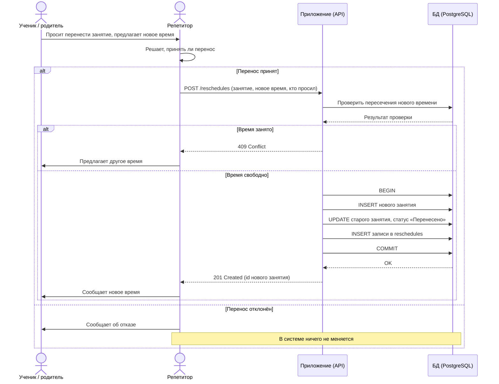

Sequence-диаграмма переноса занятия

Сценарий из US-2: Ученик или родитель просит перенести занятие, репетитор решает, принять ли перенос, а система фиксирует результат в базе данных. Решение принимает репетитор вне системы, поэтому при отказе в БД ничего не меняется.

Пояснения:

1) Приложение (API) - целевое приложение между репетитором и базой данных, которое будет предоставлять методы из 'api/openapi.yaml'. В учебном проекте оно не реализовано: его роль выполняют SQL-команды, которые репетитор запускает в клиенте БД. Диаграмма показывает, как взаимодействие выглядело бы в готовом сервисе.
2) Проверка пересечений выполняется запросом к 'lessons' (FR-3). Схема БД пересечения не запрещает, поэтому проверка нужна до записи.
3) Три записи в одной транзакции (BEGIN … COMMIT): новое занятие, смена статуса старого, запись о переносе. Либо проходят все три, либо ни одна.

